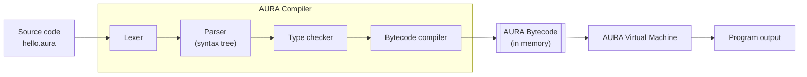

<div align="center">

# AURA

**Advanced Unified Runtime Architecture**

*Give ideas the power to become reality.*

[](https://github.com/sarvessveeriyah2312/AURA-Advanced_Unified_Runtime_Architecture/actions/workflows/ci.yml)
[](https://github.com/sarvessveeriyah2312/AURA-Advanced_Unified_Runtime_Architecture/releases/latest)
[](LICENSE)
[](go.mod)

A small, statically typed, general-purpose programming language with a
bytecode compiler and virtual machine, written in Go.

**Version 0.1.0** · macOS · Linux · Windows ·
[Repository](https://github.com/sarvessveeriyah2312/AURA-Advanced_Unified_Runtime_Architecture) ·
[Latest release](https://github.com/sarvessveeriyah2312/AURA-Advanced_Unified_Runtime_Architecture/releases/latest)

</div>

``` aura
fn main() -> Unit {
    let name = "AURA"
    print("Hello, ${name}!")
}
```

``` text
$ aura run hello.aura
Hello, AURA!
```

------------------------------------------------------------------------

## Contents

-   [What is AURA?](#what-is-aura)
-   [Key features](#key-features)
-   [How AURA works](#how-aura-works)
-   [Installation](#installation)
-   [Quick start](#quick-start)
-   [Language tutorial](#language-tutorial)
-   [CLI reference](#cli-reference)
-   [Language reference](#language-reference)
-   [Errors and diagnostics](#errors-and-diagnostics)
-   [Current limitations](#current-limitations)
-   [Roadmap](#roadmap)
-   [Repository structure](#repository-structure)
-   [Development](#development)
-   [Contributing](#contributing)
-   [The AURA name](#the-aura-name)
-   [License](#license)

## What is AURA?

AURA is a small, statically typed, general-purpose programming language.

-   You write programs in `.aura` files.
-   The `aura` command checks a program for mistakes before running it,
    compiles it to bytecode, and executes that bytecode on the AURA
    Virtual Machine.

The design goals:

| Goal | In practice |
|---|---|
| **Readable** | Clean syntax with no semicolons: a new line ends a statement. |
| **Predictable** | Every type, operator, and error is specified. Integer overflow is an error, never a silent wrap-around. |
| **Safe before running** | Type errors are found before any code executes. |
| **Helpful errors** | Every error has a stable code (such as `AURA-T001`), an exact line and column, and a pointer to the problem. |
| **Small and understandable** | A compiler and runtime that one developer can read and extend. |

> **Status: 0.1.0, released 2026-11-12.** This is the first public
> version: a deliberately small language core, tested on Linux, macOS,
> and Windows. AURA 0.x is experimental, and the language may change
> between minor versions. Every change is recorded in
> [`CHANGELOG.md`](CHANGELOG.md).

## Key features

All of the following are implemented in AURA 0.1.0:

-   **Static typing with inference:** `Int`, `Float`, `Bool`, `String`,
    and `Unit`, with no implicit conversions.
-   **Variables:** immutable `let` by default, and `let mut` for values
    that change.
-   **Functions:** typed parameters, explicit return types, recursion,
    and calls in any order.
-   **Control flow:** `if`, `else if`, and `else`.
-   **Checked integer arithmetic:** overflow and division by zero are
    reported as errors, not silent wrong answers.
-   **Strings:** escape sequences, and `${...}` interpolation of any
    expression.
-   **Diagnostics:** 47 stable error codes, precise positions, underlined
    source excerpts, and several errors reported per run.
-   **A typed bytecode VM:** programs compile to validated, typed
    instructions that execute in a stack-based virtual machine.
-   **Cross-platform:** prebuilt binaries for macOS, Linux, and Windows,
    with no dependencies.

## How AURA works



| Component | What it does |
|---|---|
| **AURA Compiler** | Turns source text into bytecode, in four stages. **Lexer:** splits the text into tokens. **Parser:** builds a syntax tree and checks the grammar. **Type checker:** resolves names and checks every type. **Bytecode compiler:** emits typed instructions. If any stage finds errors, they are reported and nothing runs. |
| **AURA Bytecode** | A compact list of typed instructions, for example "add two `Int`s". It is validated before execution. In 0.1.0 it exists **only in memory**: there are no bytecode files. |
| **AURA Virtual Machine** | A stack-based interpreter that executes the bytecode. It stops with a clear error on integer overflow, division by zero, or excessive call depth. |
| **AURA CLI** | The `aura` command. `aura check` runs only the compiler; `aura run` runs the whole pipeline. |

AURA does **not** compile to native machine code. `aura run` compiles and
executes a program each time.

## Installation

Choose one of three methods:

| Method | Best for | Requires Go? |
|---|---|---|
| [A. Download a release](#method-a-download-a-release-recommended) (recommended) | Using AURA | **No** |
| [B. Install with Go](#method-b-install-with-go) | Go developers | Yes, Go 1.25 or later |
| [C. Build from source](#method-c-build-from-source) | Contributors | Yes, Go 1.25 or later |

### Method A: Download a release (recommended)

**A prebuilt AURA release does not need Go or any other software.** Each
archive contains a single, self-contained `aura` executable.

Download from the
[v0.1.0 release page](https://github.com/sarvessveeriyah2312/AURA-Advanced_Unified_Runtime_Architecture/releases/tag/v0.1.0):

| Platform | Archive | Minimum OS |
|---|---|---|
| macOS, Apple silicon | `aura_0.1.0_darwin_arm64.tar.gz` | macOS 12 |
| macOS, Intel | `aura_0.1.0_darwin_amd64.tar.gz` | macOS 12 |
| Linux, x86-64 | `aura_0.1.0_linux_amd64.tar.gz` | kernel 3.2 (not WSL 1) |
| Linux, ARM64 | `aura_0.1.0_linux_arm64.tar.gz` | kernel 3.2 |
| Windows, x86-64 | `aura_0.1.0_windows_amd64.zip` | Windows 10 / Server 2016 |

Each archive unpacks to a folder containing:

-   `aura` (`aura.exe` on Windows);
-   `LICENSE`;
-   `README.md`;
-   `CHANGELOG.md`;
-   `THIRD_PARTY_NOTICES.txt`.

The release also provides `SHA256SUMS`, to verify your download, and
`BUILD-INFO.txt`, which describes how the binaries were built.

#### macOS

``` bash
# Apple silicon. For an Intel Mac, use aura_0.1.0_darwin_amd64.tar.gz.
ARCHIVE=aura_0.1.0_darwin_arm64.tar.gz
BASE=https://github.com/sarvessveeriyah2312/AURA-Advanced_Unified_Runtime_Architecture/releases/download/v0.1.0

curl -fLO "$BASE/$ARCHIVE"
curl -fLO "$BASE/SHA256SUMS"
shasum -a 256 -c SHA256SUMS --ignore-missing      # expect: <archive>: OK

tar -xzf "$ARCHIVE"
sudo mkdir -p /usr/local/bin
sudo install -m 0755 "${ARCHIVE%.tar.gz}/aura" /usr/local/bin/aura
aura version                                      # aura 0.1.0
```

The binaries are not code-signed. Files downloaded with `curl` run
normally. If you download the archive in a **browser**, macOS Gatekeeper
may block `aura`. After verifying the checksum, remove the quarantine
flag:

``` bash
xattr -d com.apple.quarantine /usr/local/bin/aura
```

#### Linux

``` bash
# x86-64. For ARM64, use aura_0.1.0_linux_arm64.tar.gz.
ARCHIVE=aura_0.1.0_linux_amd64.tar.gz
BASE=https://github.com/sarvessveeriyah2312/AURA-Advanced_Unified_Runtime_Architecture/releases/download/v0.1.0

curl -fLO "$BASE/$ARCHIVE"
curl -fLO "$BASE/SHA256SUMS"
sha256sum -c SHA256SUMS --ignore-missing           # expect: <archive>: OK

tar -xzf "$ARCHIVE"
sudo install -m 0755 "${ARCHIVE%.tar.gz}/aura" /usr/local/bin/aura
aura version                                       # aura 0.1.0
```

The Linux binaries are statically linked and need no system libraries.

**Without `sudo`:** install into `~/.local/bin` instead, and make sure
that directory is on your `PATH`:

``` bash
mkdir -p ~/.local/bin
install -m 0755 "${ARCHIVE%.tar.gz}/aura" ~/.local/bin/aura
```

**Arch Linux users:** the AUR package manager `aura` (`fosskers/aura`)
installs a command with the same name. If you use it, install this
`aura` under a different file name, such as `aura-lang`, or run it by
its full path.

#### Windows (PowerShell)

``` powershell
$Base = "https://github.com/sarvessveeriyah2312/AURA-Advanced_Unified_Runtime_Architecture/releases/download/v0.1.0"
Invoke-WebRequest "$Base/aura_0.1.0_windows_amd64.zip" -OutFile aura_0.1.0_windows_amd64.zip
Invoke-WebRequest "$Base/SHA256SUMS" -OutFile SHA256SUMS

# Verify: both lines must show the same hash.
(Select-String -Path SHA256SUMS -Pattern "windows_amd64.zip").Line.Split(" ")[0]
(Get-FileHash aura_0.1.0_windows_amd64.zip -Algorithm SHA256).Hash.ToLower()

Expand-Archive aura_0.1.0_windows_amd64.zip -DestinationPath .
$Dest = "$env:LOCALAPPDATA\Programs\aura"
New-Item -ItemType Directory -Force $Dest | Out-Null
Copy-Item .\aura_0.1.0_windows_amd64\aura.exe $Dest
[Environment]::SetEnvironmentVariable("Path", [Environment]::GetEnvironmentVariable("Path", "User") + ";$Dest", "User")
```

Open a **new** terminal, so that it picks up the updated `PATH`, then
run `aura version`. It should print `aura 0.1.0`. SmartScreen may warn
the first time, because the binary is not code-signed.

### Method B: Install with Go

This method needs **Go 1.25 or later**; `go.mod` declares `go 1.25.0`.
Go 1.21 or later can download the required toolchain automatically.

``` bash
go install github.com/sarvessveeriyah2312/AURA-Advanced_Unified_Runtime_Architecture/cmd/aura@v0.1.0
```

Go installs `aura` into `$(go env GOBIN)`, or into
`$(go env GOPATH)/bin` (usually `~/go/bin`) when `GOBIN` is not set.
That directory must be on your `PATH`:

``` bash
export PATH="$PATH:$(go env GOPATH)/bin"   # add this to your shell profile
aura version                               # aura 0.1.0
```

### Method C: Build from source

This method needs **Go 1.25 or later** and Git. AURA has no other
dependencies.

``` bash
git clone https://github.com/sarvessveeriyah2312/AURA-Advanced_Unified_Runtime_Architecture.git
cd AURA-Advanced_Unified_Runtime_Architecture
go build -o ./bin/aura ./cmd/aura
./bin/aura version                       # aura 0.1.0
./bin/aura run examples/hello.aura       # Hello, AURA!
```

The source on the `main` branch may be ahead of the latest release. To
build exactly 0.1.0, run `git checkout v0.1.0` first.

## Quick start

1.  **Install AURA** with [Method A](#method-a-download-a-release-recommended).
2.  **Check the installation:**

    ``` text
    $ aura version
    aura 0.1.0
    ```

3.  **Create** a file named `hello.aura`:

    ``` aura
    fn main() -> Unit {
        let name = "AURA"
        print("Hello, ${name}!")
    }
    ```

4.  **Check it** for errors. No output means no errors:

    ``` text
    $ aura check hello.aura
    ```

5.  **Run it:**

    ``` text
    $ aura run hello.aura
    Hello, AURA!
    ```

Next, work through the [Language tutorial](#language-tutorial).

## Language tutorial

Each lesson is a complete program. Save it as a `.aura` file and run it
with `aura run`. The output shown is exactly what AURA 0.1.0 prints.

1.  [Program structure and comments](#1-program-structure-and-comments)
2.  [Variables and mutability](#2-variables-and-mutability)
3.  [Static types and type inference](#3-static-types-and-type-inference)
4.  [Arithmetic and operators](#4-arithmetic-and-operators)
5.  [Boolean expressions](#5-boolean-expressions)
6.  [Conditional statements](#6-conditional-statements)
7.  [Strings and interpolation](#7-strings-and-interpolation)
8.  [Functions and return values](#8-functions-and-return-values)
9.  [Recursion](#9-recursion)
10. [Built-in functions](#10-built-in-functions)
11. [Putting it together: FizzBuzz](#11-putting-it-together-fizzbuzz)

### 1. Program structure and comments

``` aura
// hello.aura: every program starts in main.
/* Block comments
   can span several lines. */
module hello

fn main() -> Unit {
    print("Hello from AURA")   // prints one line
}
```

``` text
Hello from AURA
```

-   **`main` is required:** every program has exactly one
    `fn main() -> Unit`, and execution starts there.
-   **No semicolons:** a newline ends a statement. A long expression
    may continue on the next line after an operator such as `+`, or
    inside parentheses.
-   **`module`:** an optional `module` declaration may appear first. In
    0.1.0, a program is a single file and the name has no other effect.
-   **Order:** functions may appear in any order.

### 2. Variables and mutability

``` aura
fn main() -> Unit {
    let language = "AURA"        // immutable
    let mut visits = 0           // mutable
    visits = visits + 1
    visits = visits + 1
    print(language)
    print(visits)
}
```

``` text
AURA
2
```

`let` creates a binding that cannot be reassigned. Use `let mut` when
the value needs to change. Assigning to a `let` binding is a
compile-time error (`AURA-T004`).

### 3. Static types and type inference

``` aura
fn main() -> Unit {
    let count: Int = 3
    let price: Float = 2.5
    let label: String = "items"
    let doubled = count * 2          // inferred as Int
    print(doubled)
    print(price * 2.0)
    print(toString(count) + " " + label)
}
```

``` text
6
5.0
3 items
```

-   **The five types:** `Int`, `Float`, `Bool`, `String`, and `Unit`.
-   **Annotations are optional** when the value determines the type.
-   **No implicit conversions:** `Int` and `Float` never mix, so this
    is rejected before the program runs:

``` aura
fn main() -> Unit {
    let count = 3
    let price = 2.5
    print(count * price)
}
```

``` text
$ aura check mixed.aura
error[AURA-T007]: operator '*' cannot be applied to Int and Float
  --> mixed.aura:4:11
   |
 4 |     print(count * price)
   |           ^^^^^^^^^^^^^
```

### 4. Arithmetic and operators

``` aura
fn main() -> Unit {
    print(7 / 2)                 // Int division truncates
    print(7 % 2)
    print(-7 / 2)
    print(7.0 / 2.0)             // Float division
    print(2 + 3 * 4)             // precedence: * before +
    print((2 + 3) * 4)
    print("AU" + "RA")           // String concatenation
    print("count: " + toString(42))
}
```

``` text
3
1
-3
3.5
14
20
AURA
count: 42
```

-   **`Int` arithmetic is checked.** Overflow (`AURA-R005`), and
    division or remainder by zero (`AURA-R001`), stop the program with
    an error.
-   **`Int` division** rounds toward zero, and `%` takes the sign of
    the left operand.
-   **`Float` follows IEEE-754.** For example, `1.0 / 0.0` is `+Inf`,
    not an error.

### 5. Boolean expressions

``` aura
fn main() -> Unit {
    let age = 20
    let member = false
    let adult = age >= 18
    print(adult)
    print(adult && member)
    print(adult || member)
    print(!member)
    print(age == 20 && age != 21)
}
```

``` text
true
false
true
true
true
```

-   **Short-circuit:** `&&` and `||` evaluate the right-hand side only
    when it is needed.
-   **Comparisons:** `==` and `!=` work on two values of the same type.
    `<`, `<=`, `>`, and `>=` work on `Int` or `Float`.

### 6. Conditional statements

``` aura
fn main() -> Unit {
    grade(91)
    grade(72)
    grade(40)
}

fn grade(score: Int) -> Unit {
    if score >= 80 {
        print("${score}: A")
    } else if score >= 60 {
        print("${score}: B")
    } else {
        print("${score}: try again")
    }
}
```

``` text
91: A
72: B
40: try again
```

-   **The condition must be a `Bool`.** `if 1 { … }` is an error.
-   **Braces are required:** the `{` goes on the same line as the `if`,
    and `else` on the same line as the preceding `}`.
-   **`if` is a statement,** not an expression.

### 7. Strings and interpolation

``` aura
fn main() -> Unit {
    let item = "coffee"
    let price = 4
    let qty = 3
    print("${qty} x ${item} = ${price * qty}")
    print("Tab:\tdone")
    print("Quote: \"AURA\"")
    print("Literal: \${not interpolated}")
}
```

``` text
3 x coffee = 12
Tab:	done
Quote: "AURA"
Literal: ${not interpolated}
```

-   **Interpolation:** `${...}` inserts any expression of type `Int`,
    `Float`, `Bool`, or `String`, including arithmetic and calls.
-   **Escapes:** `\n`, `\t`, `\r`, `\"`, `\\`, and `\$`.
-   **One line only:** a string must start and end on the same line. It
    may contain any Unicode text.

### 8. Functions and return values

``` aura
fn main() -> Unit {
    print(square(9))
    print(greet("Ada"))
    announce("AURA")
}

fn square(n: Int) -> Int {
    return n * n
}

fn greet(name: String) -> String {
    return "Hello, ${name}!"
}

fn announce(name: String) -> Unit {
    print("Welcome to ${name}")
}
```

``` text
81
Hello, Ada!
Welcome to AURA
```

-   **Signatures:** every parameter has a type, and every function
    declares its return type after `->`.
-   **Returning a value:** such a function must `return` one on every
    path (`AURA-T008`).
-   **`Unit` functions** return nothing, and may use a bare `return` to
    stop early.

### 9. Recursion

AURA 0.1.0 has no loops, so repetition uses recursion:

``` aura
fn main() -> Unit {
    countdown(3)
    print(sum(100))
}

fn countdown(n: Int) -> Unit {
    if n == 0 {
        print("Liftoff!")
        return
    }
    print(n)
    countdown(n - 1)
}

fn sum(n: Int) -> Int {
    if n == 0 {
        return 0
    }
    return n + sum(n - 1)
}
```

``` text
3
2
1
Liftoff!
5050
```

Calls may nest up to 10,000 deep, including `main`. Deeper recursion
stops with `AURA-R003`.

### 10. Built-in functions

``` aura
fn main() -> Unit {
    print(42)
    print(3.0)
    print(0.1 + 0.2)
    print(true)
    print("text")
    print(toString(1.5) + " / " + toString(false))
}
```

``` text
42
3.0
0.30000000000000004
true
text
1.5 / false
```

| Function | Description |
|---|---|
| `print(value)` | Prints an `Int`, `Float`, `Bool`, or `String`, followed by a newline. |
| `toString(value)` | Returns the text of an `Int`, `Float`, `Bool`, or `String`. |

A `Float` always prints with a decimal point (`3.0`), using the shortest
text that reads back as the same value. Built-in names cannot be
redefined.

### 11. Putting it together: FizzBuzz

``` aura
// FizzBuzz from 1 to 15, using recursion instead of a loop.
fn main() -> Unit {
    fizzbuzz(1, 15)
}

fn fizzbuzz(n: Int, last: Int) -> Unit {
    if n > last {
        return
    }
    if n % 15 == 0 {
        print("FizzBuzz")
    } else if n % 3 == 0 {
        print("Fizz")
    } else if n % 5 == 0 {
        print("Buzz")
    } else {
        print(n)
    }
    fizzbuzz(n + 1, last)
}
```

``` text
1
2
Fizz
4
Buzz
Fizz
7
8
Fizz
Buzz
11
Fizz
13
14
FizzBuzz
```

## CLI reference

``` text
aura <command> [arguments]
```

| Command | Purpose | Output | Exit code |
|---|---|---|---|
| `aura run <file.aura>` | Check, compile, and run a program. It runs only if there are no compile-time errors. | Program output on stdout; errors on stderr | `0`, `1`, `2`, or `3` |
| `aura check <file.aura>` | Check a program without running it. | Nothing on success; errors on stderr | `0`, `1`, or `2` |
| `aura version` | Print the version. | `aura 0.1.0` on stdout | `0` |
| `aura help` | Print usage. | Usage on stdout | `0` |

Flags: `--version` is the same as `aura version`; `-h` and `--help` are
the same as `aura help`.

**Behaviour:**

-   **The file must end in `.aura`,** in lower case. Any other name is
    rejected with exit code `2`, before the file is read.
-   **Wrong usage exits with `2`** and prints usage on stderr. That
    covers no command, an unknown command, a missing file argument, and
    extra arguments.
-   **Several compile-time errors** are reported in one run, separated by
    blank lines.
-   **Output order:** program output is written as the program runs, so
    output printed before a runtime error is kept.

**Exit codes:**

| Code | Meaning |
|---|---|
| `0` | Success. |
| `1` | The program has errors, found by the compiler or at run time. |
| `2` | Usage error: a wrong command or arguments, a file not ending in `.aura`, or an unreadable file. |
| `3` | Internal failure, such as failing to write program output, or an internal compiler or VM error. |

Exit codes make `aura` easy to script:

``` bash
aura check app.aura && aura run app.aura
```

## Language reference

**Types**

| Type | Values | Literals |
|---|---|---|
| `Int` | 64-bit signed integer, with checked arithmetic | `42`, `-7` |
| `Float` | 64-bit IEEE-754 floating point | `3.14`, `1.0`: decimal digits on both sides of `.`, and no exponent |
| `Bool` | `true` or `false` | `true` |
| `String` | Unicode text | `"hi ${name}"` |
| `Unit` | No value: the return type of `main` and of procedures | none |

**Operators**, from highest to lowest precedence:

| Precedence | Operators | Operands |
|---|---|---|
| 1 | `( )`, function calls | none |
| 2 | `!`, unary `-` | `Bool`; `Int` or `Float` |
| 3 | `*` `/` `%` | `Int` or `Float` (`%`: `Int` only) |
| 4 | `+` `-` | `Int` or `Float`; `+` also joins two `String`s |
| 5 | `<` `<=` `>` `>=` | `Int` or `Float` |
| 6 | `==` `!=` | two values of the same type |
| 7 | `&&` | `Bool` |
| 8 | `\|\|` | `Bool` |

-   **Both operands must have the same type.** Binary operators
    associate to the left.
-   **Assignment (`=`) is a statement,** not an expression.
-   **Only a function call can stand alone as a statement.** For
    example, `x + 1` on a line by itself is an error.

**Keywords:**

-   **In use:** `fn`, `let`, `mut`, `if`, `else`, `return`, `true`,
    `false`, `module`.
-   **Reserved for the future**, and not usable as names: `for`,
    `while`, `match`, `class`, `interface`, `enum`, `import`, `pub`,
    `async`, `await`.

**Names** use ASCII letters, digits, and `_`, and must not start with a
digit. The type names (`Int`, `String`, …) are not keywords.

**Scope:**

-   blocks create scopes;
-   a name is visible after its declaration;
-   an inner block may shadow an outer name, but one scope cannot
    declare the same name twice.

## Errors and diagnostics

Every error shows:

-   a stable code;
-   the file, line, and column;
-   the source line, with the problem underlined;
-   help where available.

**Compile-time errors** stop the program before it runs. All of them
are reported together:

``` aura
fn main() -> Unit {
    let total: Int = "ten"
    let limit = 5
    limit = 6
}
```

``` text
$ aura check mistakes.aura
error[AURA-T001]: expected Int but found String
  --> mistakes.aura:2:22
   |
 2 |     let total: Int = "ten"
   |                      ^^^^^

error[AURA-T004]: cannot assign twice to immutable variable 'limit'
  --> mistakes.aura:4:5
   |
 4 |     limit = 6
   |     ^^^^^^^^^
   = help: declare it with 'let mut' to allow assignment
   = note: variable declared here (mistakes.aura:3:9)
```

**Runtime errors** stop the program at the failing operation, and name
the function it was in:

``` aura
fn main() -> Unit {
    let items = 0
    print("Splitting the bill...")
    print(100 / items)
}
```

``` text
$ aura run crash.aura
Splitting the bill...
error[AURA-R001]: division by zero (in function 'main')
  --> crash.aura:4:11
   |
 4 |     print(100 / items)
   |           ^^^^^^^^^^^
```

**Error code families.** The letter shows which stage found the
problem:

| Code | Stage | Examples |
|---|---|---|
| `AURA-Lnnn` | Lexer | invalid character, bad escape, unterminated string, malformed number |
| `AURA-Pnnn` | Parser | unexpected token, missing brace, nesting too deep |
| `AURA-Tnnn` | Type checker | type mismatch, undefined name, assignment to immutable, missing return |
| `AURA-Rnnn` | Runtime | division by zero, integer overflow, call depth exceeded |
| `AURA-Cnnn` | Compiler internal | indicates a bug in AURA; please [report it](https://github.com/sarvessveeriyah2312/AURA-Advanced_Unified_Runtime_Architecture/issues) |

## Current limitations

AURA 0.1.0 is intentionally small.

**Not yet in the language:**

-   loops: `for` and `while` are reserved; use recursion;
-   arrays, maps, or other collections;
-   structs, classes, enums, generics, or pattern matching;
-   function values or closures;
-   imports or multi-file programs;
-   input, file access, or networking (the only output is `print`).

**Tooling:**

-   no REPL, formatter, debugger, or editor (LSP) support;
-   no native compilation, and no saved bytecode files.

**Implementation limits:**

-   **Nesting:** limited to 10,000 levels of parentheses, blocks, or
    `else if` chains (`AURA-P014`).
-   **Calls:** limited to 10,000 deep, including `main` (`AURA-R003`).
-   **Runtime errors** name the function they occurred in, but do not
    show the chain of calls that led there.
-   **Binaries** are not code-signed.

## Roadmap

There are no delivery dates. The status reflects actual work in the
repository:

| Area | Status | Notes |
|---|---|---|
| Core language, compiler, VM, and CLI | **Implemented** | Released in 0.1.0. |
| Runtime stack traces | **In progress** | Show every active call when a runtime error occurs. Designed and implemented on a development branch; not yet in a release. |
| Loops (`while`, then `for`) | **Planned** | The next language feature. They remove the need for recursion when repeating work. |
| Collections (arrays, maps) | Under consideration | |
| Generics, enums, and pattern matching | Under consideration | |
| Imports and multi-file programs | Under consideration | |
| Structured error handling (`Result`) | Under consideration | |
| Formatter, test runner, and editor support (LSP) | Under consideration | |
| File and network APIs | Under consideration | |
| Saved bytecode files, and native compilation | Under consideration | |

## Repository structure

``` text
cmd/aura/                the aura executable (entry point only)
internal/
  source/                source files, spans, line and column mapping
  token/                 token kinds
  lexer/                 source text -> tokens
  ast/                   syntax tree
  parser/                tokens -> syntax tree
  checker/               name resolution and type checking
  compiler/              checked program -> AURA Bytecode
  bytecode/              instruction set, values, validation
  vm/                    the AURA Virtual Machine
  diagnostic/            error codes and rendering
  cli/                   commands, pipeline, exit codes
examples/                example programs
testdata/e2e/            end-to-end test programs and expected output
scripts/
  verify.sh              the full local quality gate
  build-release.sh       reproducible release archives
  smoke-release.sh       CLI smoke test of a built binary
  package/               deterministic archive writer
.github/workflows/ci.yml continuous integration
```

The compiler phases are separate packages, and each depends only on the
earlier ones:

-   `lexer` → `parser` → `checker` → `compiler` → `vm`;
-   `cli` connects them;
-   `diagnostic` formats every error.

The VM executes validated, typed bytecode, and never panics on a user
program.

## Development

Development needs **Go 1.25 or later**, and no other dependencies.

``` bash
go build -o ./bin/aura ./cmd/aura      # build the CLI
go test ./...                          # run all tests
go vet ./...                           # static analysis
scripts/verify.sh                      # full gate: gofmt check, vet, tests, build, smoke test
```

**Testing and quality assurance:**

-   **Unit tests** cover the lexer, parser, type checker, bytecode
    compiler, VM, diagnostics, and CLI.
-   **End-to-end tests** run real programs, and compare stdout and
    stderr with the golden files in `testdata/e2e/`.
-   **Four fuzz targets** check that no input crashes the toolchain:
    `FuzzLex`, `FuzzParse`, `FuzzCheck`, and `FuzzCompileAndRun`.

    ``` bash
    go test ./internal/vm -run '^$' -fuzz=FuzzCompileAndRun -fuzztime=60s
    ```

-   **Tests are deterministic and OS-independent:** fixed random seeds,
    no timing dependencies, and no OS-specific error text.

**Continuous integration** (`.github/workflows/ci.yml`) runs on every
push and pull request to `main`, in three jobs:

1.  **verify:** `gofmt`, `go vet`, `go test`, `go build`, and
    `scripts/verify.sh`, on Linux, macOS, and Windows;
2.  **release build:** cross-compiles all five release archives twice,
    and checks that they are byte-identical;
3.  **release smoke:** runs each archive on its own platform:
    -   Linux x86-64 and ARM64;
    -   macOS Apple silicon and Intel;
    -   Windows x86-64.

**Release builds:**

``` bash
scripts/build-release.sh               # writes dist/: 5 archives, SHA256SUMS, BUILD-INFO.txt
scripts/smoke-release.sh ./bin/aura    # 10 CLI checks against a built binary
```

Release builds are reproducible: the same commit produces byte-identical
archives on any machine with the same Go version.

## Contributing

Contributions are welcome.

1.  **For language or CLI changes,** first
    [open an issue](https://github.com/sarvessveeriyah2312/AURA-Advanced_Unified_Runtime_Architecture/issues).
    Syntax and behaviour change only by a documented design decision.
2.  **Read [`CLAUDE.md`](CLAUDE.md)** for the engineering rules:
    -   separate compiler phases;
    -   no panics on user input;
    -   deterministic output;
    -   tests with every change.
3.  **Add tests** for every feature, and a regression test for every
    bug fix.
4.  **Run `scripts/verify.sh`;** it must print `OK`.
5.  **Record user-visible changes** under "Unreleased" in
    [`CHANGELOG.md`](CHANGELOG.md).

## The AURA name

AURA is the project's chosen name, and the project has decided to keep
it. The name has **not** been cleared as a trademark. The project claims
no trademark rights in it, and trademark clearance remains an open legal
question.

AURA is an independent open-source project. It is not affiliated with
or endorsed by:

-   Salesforce (Aura Components);
-   the Arch Linux `aura` package manager;
-   Neo4j (Aura);
-   any other product or project named Aura.

## License

AURA is released under the [MIT License](LICENSE).
Copyright (c) 2026 Sarvess Veeriyah.

Release binaries include the Go runtime and standard library, which are
distributed under Go's BSD-style license. The notice is in
`THIRD_PARTY_NOTICES.txt` in each release archive. AURA has no other
dependencies.
