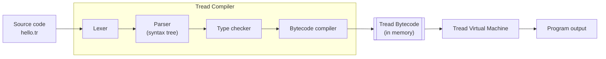

<div align="center">

# Tread

*A language for learning how languages work.*

[](https://github.com/sarvessveeriyah2312/Tread/actions/workflows/ci.yml)
[](https://github.com/sarvessveeriyah2312/Tread/releases/latest)
[](LICENSE)
[](go.mod)

A small, statically typed programming language whose whole toolchain
(lexer, parser, type checker, bytecode compiler, and virtual machine) is
built to be read, one stage at a time. Written in Go.

**Version 0.6.0** · macOS · Linux · Windows ·
[Website](https://treadlang.vercel.app/) ·
[Repository](https://github.com/sarvessveeriyah2312/Tread) ·
[Latest release](https://github.com/sarvessveeriyah2312/Tread/releases/latest)

</div>

``` tread
fn main() -> Unit {
    let name = "Tread"
    print("Hello, ${name}!")
}
```

``` text
$ tread run hello.tr
Hello, Tread!
```

------------------------------------------------------------------------

## Contents

-   [What is Tread?](#what-is-tread)
-   [Key features](#key-features)
-   [How Tread works](#how-tread-works)
-   [Installation](#installation)
-   [Quick start](#quick-start)
-   [Language tutorial](#language-tutorial)
-   [CLI reference](#cli-reference)
-   [Language reference](#language-reference)
-   [Errors and diagnostics](#errors-and-diagnostics)
-   [Current limitations](#current-limitations)
-   [Roadmap](#roadmap)
-   [Repository structure](#repository-structure)
-   [Development](#development)
-   [Contributing](#contributing)
-   [The Tread name](#the-tread-name)
-   [License](#license)

## What is Tread?

Tread is a small, statically typed, general-purpose programming language,
and **a language for learning how languages work**. Every stage that turns
source code into a running program is a separate, readable Go package, so
you can follow a program from text to tokens, to a syntax tree, to checked
types, to bytecode, to execution, one step at a time.

-   You write programs in `.tr` files.
-   The `tread` command checks a program for mistakes before running it,
    compiles it to bytecode, and executes that bytecode on the Tread
    Virtual Machine.

The design goals:

| Goal | In practice |
|---|---|
| **Readable** | Clean syntax with no semicolons: a new line ends a statement. |
| **Predictable** | Every type, operator, and error is specified. Integer overflow is an error, never a silent wrap-around. |
| **Safe before running** | Type errors are found before any code executes. |
| **Helpful errors** | Every error has a stable code (such as `TR-T001`), an exact line and column, and a pointer to the problem. |
| **Small and understandable** | A compiler and runtime that one developer can read and extend. |

> **Status: 0.6.0, released 2026-11-13.** A deliberately small language
> core, tested on Linux, macOS, and Windows. 0.6.0 adds structs, methods
> in `impl` blocks, and programs made of several files with `import`
> and `pub`.
> Tread 0.x is experimental, and the language may change between minor
> versions. Every change is recorded in
> [`CHANGELOG.md`](CHANGELOG.md).

## Key features

All of the following are implemented in Tread 0.6.0:

-   **Static typing with inference:** `Int`, `Float`, `Bool`, `String`,
    and `Unit`, with no implicit conversions.
-   **Variables:** immutable `let` by default, and `let mut` for values
    that change.
-   **Functions:** typed parameters, explicit return types, recursion,
    and calls in any order.
-   **Control flow:** `if`, `else if`, and `else`; `while` and
    `for i in a..b` loops with `break` and `continue`.
-   **Collections:** `Array<T>` and `Map<K, V>` with value semantics,
    indexing, and methods such as `push`, `get`, and `keys`.
-   **Enums and pattern matching:** variants that carry values, and a
    `match` that the compiler checks covers every case.
-   **Generics:** generic functions, enums and structs, with types
    inferred from the arguments, and the built-in `Option<T>`.
-   **Structs and methods:** your own record types with value semantics,
    and methods in `impl` blocks; `mut self` methods change their
    receiver.
-   **Modules:** split a program into files with `import`, and choose
    what other files can use with `pub`.
-   **Checked integer arithmetic:** overflow and division by zero are
    reported as errors, not silent wrong answers.
-   **Strings:** escape sequences, and `${...}` interpolation of any
    expression.
-   **Diagnostics:** 69 stable error codes, precise positions, underlined
    source excerpts, and several errors reported per run.
-   **Stack traces:** a runtime error inside a function shows every
    call that led to it.
-   **A typed bytecode VM:** programs compile to validated, typed
    instructions that execute in a stack-based virtual machine.
-   **Cross-platform:** prebuilt binaries for macOS, Linux, and Windows,
    with no dependencies.

## How Tread works



| Component | What it does |
|---|---|
| **Tread Compiler** | Turns source text into bytecode, in four stages. **Lexer:** splits the text into tokens. **Parser:** builds a syntax tree and checks the grammar. **Type checker:** resolves names and checks every type. **Bytecode compiler:** emits typed instructions. If any stage finds errors, they are reported and nothing runs. |
| **Tread Bytecode** | A compact list of typed instructions, for example "add two `Int`s". It is validated before execution. It currently exists **only in memory**: there are no bytecode files. |
| **Tread Virtual Machine** | A stack-based interpreter that executes the bytecode. It stops with a clear error on integer overflow, division by zero, or excessive call depth. |
| **Tread CLI** | The `tread` command. `tread check` runs only the compiler; `tread run` runs the whole pipeline. |

Tread does **not** compile to native machine code. `tread run` compiles and
executes a program each time.

## Installation

Choose one of three methods:

| Method | Best for | Requires Go? |
|---|---|---|
| [A. Install a release](#method-a-install-a-release-recommended) (recommended) | Using Tread | **No** |
| [B. Install with Go](#method-b-install-with-go) | Go developers | Yes, Go 1.25 or later |
| [C. Build from source](#method-c-build-from-source) | Contributors | Yes, Go 1.25 or later |

### Method A: Install a release (recommended)

**A Tread release does not need Go or any other software.** Download
from the
[v0.6.0 release page](https://github.com/sarvessveeriyah2312/Tread/releases/tag/v0.6.0).
Each platform gets two downloads, plus an installer for the SDK:

| Download | What it is |
|---|---|
| `tread-sdk-0.6.0-<platform>` (`.tar.gz`, `.zip` on Windows) | **Tread SDK**: everything to write, check, build and run Tread programs |
| `tread-runtime-0.6.0-<platform>` | **Tread Runtime**: runs compiled `.tbc` programs only; no compiler |
| `.msi` (Windows), `.pkg` (macOS), `.deb` / `.rpm` (Linux) | SDK installer |
| `install.sh`, `install.ps1` | user-level install scripts (no administrator rights) |

`<platform>` is `windows-x64`, `macos-arm64`, `macos-x64`, `linux-x64`
or `linux-arm64` (macOS 12, Linux kernel 3.2, Windows 10 / Server 2016
or later). The release also has `SHA256SUMS` and `release-manifest.json`.
Every archive has the same layout:

``` text
tread-sdk-<version>-<platform>/
├── bin/tread              # tread.exe on Windows
├── docs/                  # LICENSE, README.md, CHANGELOG.md, THIRD_PARTY_NOTICES.txt
└── release                # version, edition, bytecode format, platform
```

**Installers:**

| Installer | Installs into | PATH | Uninstall |
|---|---|---|---|
| `install.sh` (macOS, Linux) | `~/.tread` | a marked block in `~/.profile` (and `~/.bashrc`, `~/.zshrc` if present) | `sh install.sh --uninstall` |
| `install.ps1` (Windows) | `%USERPROFILE%\.tread` | user `PATH`, `TREAD_HOME` | `install.ps1 -Uninstall` |
| `.msi` (Windows, per user) | `%LOCALAPPDATA%\Programs\Tread` | user `PATH`, `TREAD_HOME` | Settings → Apps |
| `.pkg` (macOS) | `/Library/Tread` | `/etc/paths.d/tread` | `sudo /Library/Tread/uninstall.sh` |
| `.deb`, `.rpm` (Linux) | `/opt/tread` | `/usr/bin/tread` link | `sudo apt remove tread` / `sudo dnf remove tread` |

The quickest way is an install script:

``` bash
# macOS / Linux, no sudo (add `-s -- --runtime` for the Runtime):
curl -fsSL https://github.com/sarvessveeriyah2312/Tread/releases/latest/download/install.sh | sh
```

``` powershell
# Windows, no administrator rights:
powershell -NoProfile -ExecutionPolicy Bypass -Command "irm https://github.com/sarvessveeriyah2312/Tread/releases/latest/download/install.ps1 | iex"
```

The install scripts verify the archive against `SHA256SUMS` before
installing, never add a duplicate `PATH` entry, only replace or remove
files they installed, and refuse to install into a directory that is
not empty and not a previous Tread installation. Upgrading is running
the installer again with a newer version. `TREAD_HOME` is optional:
`tread` finds its installation from its own location.

**Installing an archive by hand** (macOS Apple silicon shown; use your
platform's name):

``` bash
ARCHIVE=tread-sdk-0.6.0-macos-arm64.tar.gz
BASE=https://github.com/sarvessveeriyah2312/Tread/releases/download/v0.6.0
curl -fLO "$BASE/$ARCHIVE"
curl -fLO "$BASE/SHA256SUMS"
shasum -a 256 -c SHA256SUMS --ignore-missing      # Linux: sha256sum; expect: <archive>: OK
tar -xzf "$ARCHIVE"
mv "${ARCHIVE%.tar.gz}" ~/tread-sdk               # any location works
export PATH="$HOME/tread-sdk/bin:$PATH"           # add this to your shell profile
```

On Windows, expand `tread-sdk-0.6.0-windows-x64.zip` and add its `bin`
folder to your user `PATH`. If you download in a browser on macOS,
Gatekeeper may block `tread`; after checking the checksum, run
`xattr -d com.apple.quarantine <path>/bin/tread`.

Then open a new terminal and check the installation:

``` text
$ tread doctor
Tread Installation Diagnostics

[OK]   Tread CLI: tread <version> (SDK) at /home/you/.tread/bin/tread
[OK]   Installation: /home/you/.tread (Tread SDK <version>, linux-x64)
[OK]   TREAD_HOME: /home/you/.tread
[OK]   PATH: tread resolves to this executable
[OK]   Runtime: encoded, verified and ran a test program (bytecode format 1)
[OK]   Bytecode compatibility: format 1 loads; format 2 is rejected with a rebuild hint
[OK]   SDK compiler: compiled a test program to bytecode and ran it
[OK]   Standard library: built-in print and toString work (no library modules in this release)

Installation is healthy.
```

The installers and binaries are **not code-signed** yet, so macOS
Gatekeeper and Windows SmartScreen may warn on first use. Verify
downloads with `SHA256SUMS`.

### Method B: Install with Go

This method needs **Go 1.25 or later**; `go.mod` declares `go 1.25.0`.
Go 1.21 or later can download the required toolchain automatically.

``` bash
go install github.com/sarvessveeriyah2312/Tread/cmd/tread@v0.6.0
```

Go installs `tread` into `$(go env GOBIN)`, or into
`$(go env GOPATH)/bin` (usually `~/go/bin`) when `GOBIN` is not set.
That directory must be on your `PATH`:

``` bash
export PATH="$PATH:$(go env GOPATH)/bin"   # add this to your shell profile
tread version                              # tread 0.6.0
```

### Method C: Build from source

This method needs **Go 1.25 or later** and Git. Tread has no other
dependencies.

``` bash
git clone https://github.com/sarvessveeriyah2312/Tread.git
cd Tread
go build -o ./bin/tread ./cmd/tread
./bin/tread version                      # tread 0.6.0
./bin/tread run examples/hello.tr        # Hello, Tread!
```

The source on the `main` branch may be ahead of the latest release. To
build exactly 0.6.0, run `git checkout v0.6.0` first.

## Quick start

1.  **Install Tread** with [Method A](#method-a-install-a-release-recommended).
2.  **Check the installation:**

    ``` text
    $ tread version
    tread 0.6.0
    ```

3.  **Create** a file named `hello.tr`:

    ``` tread
    fn main() -> Unit {
        let name = "Tread"
        print("Hello, ${name}!")
    }
    ```

4.  **Check it** for errors. No output means no errors:

    ``` text
    $ tread check hello.tr
    ```

5.  **Run it:**

    ``` text
    $ tread run hello.tr
    Hello, Tread!
    ```

Next, work through the [Language tutorial](#language-tutorial).

## Language tutorial

Each lesson is a complete program. Save it as a `.tr` file and run it
with `tread run`. The output shown is exactly what Tread 0.6.0 prints.

1.  [Program structure and comments](#1-program-structure-and-comments)
2.  [Variables and mutability](#2-variables-and-mutability)
3.  [Static types and type inference](#3-static-types-and-type-inference)
4.  [Arithmetic and operators](#4-arithmetic-and-operators)
5.  [Boolean expressions](#5-boolean-expressions)
6.  [Conditional statements](#6-conditional-statements)
7.  [Strings and interpolation](#7-strings-and-interpolation)
8.  [Functions and return values](#8-functions-and-return-values)
9.  [Recursion](#9-recursion)
10. [Arrays](#10-arrays)
11. [Maps](#11-maps)
12. [Enums and pattern matching](#12-enums-and-pattern-matching)
13. [Generics](#13-generics)
14. [Structs and methods](#14-structs-and-methods)
15. [Modules and imports](#15-modules-and-imports)
16. [Built-in functions](#16-built-in-functions)
17. [Putting it together: FizzBuzz](#17-putting-it-together-fizzbuzz)

### 1. Program structure and comments

``` tread
// hello.tr: every program starts in main.
/* Block comments
   can span several lines. */
module hello

fn main() -> Unit {
    print("Hello from Tread")   // prints one line
}
```

``` text
Hello from Tread
```

-   **`main` is required:** every program has exactly one
    `fn main() -> Unit`, and execution starts there.
-   **No semicolons:** a newline ends a statement. A long expression
    may continue on the next line after an operator such as `+`, or
    inside parentheses.
-   **`module`:** an optional `module` declaration may appear first. In
    a file that other files import, it must match the file's name (see
    [Modules and imports](#15-modules-and-imports)); otherwise it has no
    other effect.
-   **Order:** functions may appear in any order.

### 2. Variables and mutability

``` tread
fn main() -> Unit {
    let language = "Tread"        // immutable
    let mut visits = 0           // mutable
    visits = visits + 1
    visits = visits + 1
    print(language)
    print(visits)
}
```

``` text
Tread
2
```

`let` creates a binding that cannot be reassigned. Use `let mut` when
the value needs to change. Assigning to a `let` binding is a
compile-time error (`TR-T004`).

### 3. Static types and type inference

``` tread
fn main() -> Unit {
    let count: Int = 3
    let price: Float = 2.5
    let label: String = "items"
    let doubled = count * 2          // inferred as Int
    print(doubled)
    print(price * 2.0)
    print(toString(count) + " " + label)
}
```

``` text
6
5.0
3 items
```

-   **The five types:** `Int`, `Float`, `Bool`, `String`, and `Unit`.
-   **Annotations are optional** when the value determines the type.
-   **No implicit conversions:** `Int` and `Float` never mix, so this
    is rejected before the program runs:

``` tread
fn main() -> Unit {
    let count = 3
    let price = 2.5
    print(count * price)
}
```

``` text
$ tread check mixed.tr
error[TR-T007]: operator '*' cannot be applied to Int and Float
  --> mixed.tr:4:11
   |
 4 |     print(count * price)
   |           ^^^^^^^^^^^^^
```

### 4. Arithmetic and operators

``` tread
fn main() -> Unit {
    print(7 / 2)                 // Int division truncates
    print(7 % 2)
    print(-7 / 2)
    print(7.0 / 2.0)             // Float division
    print(2 + 3 * 4)             // precedence: * before +
    print((2 + 3) * 4)
    print("Tr" + "ead")          // String concatenation
    print("count: " + toString(42))
}
```

``` text
3
1
-3
3.5
14
20
Tread
count: 42
```

-   **`Int` arithmetic is checked.** Overflow (`TR-R005`), and
    division or remainder by zero (`TR-R001`), stop the program with
    an error.
-   **`Int` division** rounds toward zero, and `%` takes the sign of
    the left operand.
-   **`Float` follows IEEE-754.** For example, `1.0 / 0.0` is `+Inf`,
    not an error.

### 5. Boolean expressions

``` tread
fn main() -> Unit {
    let age = 20
    let member = false
    let adult = age >= 18
    print(adult)
    print(adult && member)
    print(adult || member)
    print(!member)
    print(age == 20 && age != 21)
}
```

``` text
true
false
true
true
true
```

-   **Short-circuit:** `&&` and `||` evaluate the right-hand side only
    when it is needed.
-   **Comparisons:** `==` and `!=` work on two values of the same type.
    `<`, `<=`, `>`, and `>=` work on `Int` or `Float`.

### 6. Conditional statements

``` tread
fn main() -> Unit {
    grade(91)
    grade(72)
    grade(40)
}

fn grade(score: Int) -> Unit {
    if score >= 80 {
        print("${score}: A")
    } else if score >= 60 {
        print("${score}: B")
    } else {
        print("${score}: try again")
    }
}
```

``` text
91: A
72: B
40: try again
```

-   **The condition must be a `Bool`.** `if 1 { … }` is an error.
-   **Braces are required:** the `{` goes on the same line as the `if`,
    and `else` on the same line as the preceding `}`.
-   **`if` is a statement,** not an expression.

### 7. Strings and interpolation

``` tread
fn main() -> Unit {
    let item = "coffee"
    let price = 4
    let qty = 3
    print("${qty} x ${item} = ${price * qty}")
    print("Tab:\tdone")
    print("Quote: \"Tread\"")
    print("Literal: \${not interpolated}")
}
```

``` text
3 x coffee = 12
Tab:	done
Quote: "Tread"
Literal: ${not interpolated}
```

-   **Interpolation:** `${...}` inserts any expression of type `Int`,
    `Float`, `Bool`, or `String`, including arithmetic and calls.
-   **Escapes:** `\n`, `\t`, `\r`, `\"`, `\\`, and `\$`.
-   **One line only:** a string must start and end on the same line. It
    may contain any Unicode text.

### 8. Functions and return values

``` tread
fn main() -> Unit {
    print(square(9))
    print(greet("Ada"))
    announce("Tread")
}

fn square(n: Int) -> Int {
    return n * n
}

fn greet(name: String) -> String {
    return "Hello, ${name}!"
}

fn announce(name: String) -> Unit {
    print("Welcome to ${name}")
}
```

``` text
81
Hello, Ada!
Welcome to Tread
```

-   **Signatures:** every parameter has a type, and every function
    declares its return type after `->`.
-   **Returning a value:** such a function must `return` one on every
    path (`TR-T008`).
-   **`Unit` functions** return nothing, and may use a bare `return` to
    stop early.

### 9. Recursion

Repetition can use recursion, or a [loop](#loops) (since 0.4.0):

``` tread
fn main() -> Unit {
    countdown(3)
    print(sum(100))
}

fn countdown(n: Int) -> Unit {
    if n == 0 {
        print("Liftoff!")
        return
    }
    print(n)
    countdown(n - 1)
}

fn sum(n: Int) -> Int {
    if n == 0 {
        return 0
    }
    return n + sum(n - 1)
}
```

``` text
3
2
1
Liftoff!
5050
```

Calls may nest up to 10,000 deep, including `main`. Deeper recursion
stops with `TR-R003`.

#### Loops

`while` repeats while a `Bool` condition holds. `for` counts through a
half-open `Int` range: `for i in a..b` runs with `i` = `a`, `a + 1`, …,
`b - 1`, and not at all if `a >= b`. `break` leaves the innermost loop,
and `continue` starts its next iteration.

``` tread
fn main() -> Unit {
    let mut n = 3
    while n > 0 {
        print(n)
        n = n - 1
    }
    print("Liftoff!")

    let mut total = 0
    for i in 1..101 {
        total = total + i
    }
    print(total)

    for i in 0..10 {
        if i % 2 == 0 {
            continue
        }
        if i > 5 {
            break
        }
        print("odd ${i}")
    }
}
```

``` text
3
2
1
Liftoff!
5050
odd 1
odd 3
odd 5
```

-   Both range bounds are evaluated once, before the first iteration, so
    changing a variable used in them does not change the loop.
-   The loop variable is an immutable `Int`; assigning to it is
    `TR-T004`. It exists only inside the loop.
-   `break` or `continue` outside a loop is `TR-T019`.
-   A loop uses no call depth, so it can run any number of times. A loop
    that never ends runs until you stop it (Ctrl+C).
-   A function that returns a value may end with `while true { … }` if
    that loop has no `break` of its own.

### 10. Arrays

An `Array<T>` holds values of one type, in order. Arrays have **value semantics**: assigning one, or passing it to a function, gives an independent copy, so changing one never changes another.

``` tread
fn main() -> Unit {
    let mut scores: Array<Int> = [72, 95, 64]
    scores.push(88)
    scores[0] = 75
    print(scores)
    print(scores.len())
    print(scores[1])

    let mut total = 0
    for s in scores {
        total = total + s
    }
    print("total ${total}")

    let saved = scores
    scores[1] = 0
    print(saved)
    print(scores)

    print(scores.contains(64))
    print(scores.pop())
    print(scores)
}
```

``` text
[75, 95, 64, 88]
4
95
total 322
[75, 95, 64, 88]
[75, 0, 64, 88]
true
Option.Some(88)
[75, 0, 64]
```

-   `xs[i]` reads an element; indexes start at 0, and an index outside the
    array stops the program with `TR-R007`.
-   Changing an array (`xs[i] = v`, `xs.push(v)`, `xs.pop()`) needs a
    `let mut` variable. Nested elements work too: `grid[r][c] = v`.
-   Methods: `len()`, `push(value)`, `pop()` (returns an
    [`Option`](#12-enums-and-pattern-matching)), and `contains(value)`.
-   An empty array needs its type written down: `let xs: Array<Int> = []`.
-   Copies are cheap: Tread copies an array only when a shared copy is
    changed, so a loop that keeps pushing to one array stays fast.

### 11. Maps

A `Map<K, V>` stores values by key. Keys are `Int`, `String`, or `Bool`, and a map remembers the order in which keys were first added.

``` tread
fn main() -> Unit {
    let mut ages = ["sam": 31, "ana": 28]
    ages["bob"] = 40
    ages["sam"] = 32
    print(ages)
    print(ages["ana"])

    for name in ages {
        print("${name} is ${ages[name]}")
    }

    print(ages.get("bob"))
    print(ages.get("zed"))
    print(ages.remove("bob"))
    print(ages.keys())
    print(ages.contains("bob"))
}
```

``` text
["sam": 32, "ana": 28, "bob": 40]
28
sam is 32
ana is 28
bob is 40
Option.Some(40)
Option.None
Option.Some(40)
["sam", "ana"]
false
```

-   `m[key]` reads a value; a missing key stops the program with
    `TR-R008`. Use `m.get(key)` to get an `Option` instead.
-   `m[key] = value` adds or replaces an entry (in a `let mut` variable).
-   Methods: `len()`, `get(key)`, `contains(key)`, `remove(key)`, and
    `keys()` (in insertion order). `for key in m` loops over the keys.
-   An empty map is written `[:]`, with a type annotation:
    `let m: Map<String, Int> = [:]`.

### 12. Enums and pattern matching

An `enum` lists the forms a value can take; each variant can carry values. A `match` statement runs the arm whose pattern fits.

``` tread
enum Shape {
    Circle(Float)
    Rect(Float, Float)
    Empty
}

fn area(s: Shape) -> Float {
    match s {
        Shape.Circle(r) => { return 3.14 * r * r }
        Shape.Rect(w, h) => { return w * h }
        Shape.Empty => { return 0.0 }
    }
}

fn main() -> Unit {
    let shapes = [Shape.Circle(1.0), Shape.Rect(2.0, 3.0), Shape.Empty]
    for s in shapes {
        print("${s}: ${area(s)}")
    }

    let code = 404
    match code {
        200 => { print("OK") }
        404 => { print("Not Found") }
        other => { print("status ${other}") }
    }
}
```

``` text
Shape.Circle(1.0): 3.14
Shape.Rect(2.0, 3.0): 6.0
Shape.Empty: 0.0
Not Found
```

Patterns can be a variant with patterns for its values (`Shape.Rect(w, h)`), a literal (`200`, `"yes"`, `true`), a name that binds the whole value (`other`), or `_`, which matches anything without naming it. Arms are tried from top to bottom.

**A `match` must handle every case.** Forgetting one is a compile-time error that names an example:

``` text
error[TR-T027]: this match does not cover every Light value: Light.Amber is not matched
  --> mistake.tr:9:11
   |
 9 |     match light {
   |           ^^^^^
   = help: add an arm for it, or a '_' arm to match everything else
```

The built-in `Option<T>` is an enum with two variants, `Option.Some(value)` and `Option.None`. It is what `pop`, `get`, and `remove` return when there may be no value.

### 13. Generics

Type parameters in angle brackets let one function, or one enum, work with any type. Tread works out the types from the arguments, so calls need no extra syntax.

``` tread
fn first<T>(items: Array<T>) -> Option<T> {
    if items.len() == 0 {
        return Option.None
    }
    return Option.Some(items[0])
}

enum Pair<A, B> {
    Of(A, B)
}

fn swap<A, B>(p: Pair<A, B>) -> Pair<B, A> {
    match p {
        Pair.Of(a, b) => { return Pair.Of(b, a) }
    }
}

fn main() -> Unit {
    print(first([3, 1, 2]))
    print(first(["x", "y"]))
    let none: Array<Float> = []
    print(first(none))

    match first(["tread"]) {
        Option.Some(name) => { print("hello, ${name}") }
        Option.None => { print("nobody") }
    }

    print(swap(Pair.Of(1, "one")))
}
```

``` text
Option.Some(3)
Option.Some("x")
Option.None
hello, tread
Pair.Of("one", 1)
```

-   Inside a generic function, a value of type `T` can be stored,
    passed, returned, compared with `==`, printed, and matched with a
    name or `_`. It cannot be used with arithmetic, because `T` might
    not be a number.
-   Where Tread cannot work out a type, such as `Option.None` on its
    own, write it down: `let x: Option<Int> = Option.None`.

### 14. Structs and methods

A struct groups named fields into one value. Methods go in an `impl`
block.

``` tread
struct Point {
    x: Int
    y: Int
}

impl Point {
    fn origin() -> Point {
        return Point { x: 0, y: 0 }
    }

    fn dist2(self, other: Point) -> Int {
        let dx = self.x - other.x
        let dy = self.y - other.y
        return dx * dx + dy * dy
    }

    fn move(mut self, dx: Int, dy: Int) -> Unit {
        self.x = self.x + dx
        self.y = self.y + dy
    }
}

struct Box<T> {
    value: T
}

impl Box {
    fn get(self) -> T {
        return self.value
    }
}

fn main() -> Unit {
    let mut p = Point { x: 3, y: 4 }
    let start = p
    p.move(1, 1)
    print(p)
    print(start)
    print(p.dist2(Point.origin()))

    p.x = 10
    print("x is now ${p.x}")

    let b = Box { value: "tread" }
    print(b.get())
    print(Box { value: [1, 2] })
}
```

``` text
Point { x: 4, y: 5 }
Point { x: 3, y: 4 }
41
x is now 10
tread
Box { value: [1, 2] }
```

-   **Build** a struct by naming every field, in any order:
    `Point { x: 3, y: 4 }`. Fields are separated by newlines or commas.
-   **Value semantics:** like arrays and maps, `let start = p` makes an
    independent copy, so changing `p` does not change `start`.
-   **Fields:** read with `p.x`; change with `p.x = 10` when `p` is
    `let mut`. This also works inside other values: `line.to.x = 9`,
    `points[0].x = 1`.
-   **Methods:** `self` gives read-only access to the value the method
    is called on. A `mut self` method can change it, so it can only be
    called on a `let mut` variable (or a field or element of one).
-   **Associated functions** have no `self` and are called on the type:
    `Point.origin()`.
-   **Generic structs** such as `Box<T>` work like generic enums; inside
    `impl Box`, `T` is in scope.
-   A struct literal cannot appear directly after `if`, `while`, `match`
    or `for`, where `{` starts the block: write `if p == (Point { x: 0, y: 0 }) {`.

### 15. Modules and imports

A program can be split into several files. Each file is a module.

``` tread
// shapes/circle.tr
pub struct Circle {
    pub radius: Float
}

impl Circle {
    pub fn area(self) -> Float {
        return pi() * self.radius * self.radius
    }
}

fn pi() -> Float {
    return 3.14159
}
```

``` tread
// main.tr
import shapes.circle

fn main() -> Unit {
    let c = circle.Circle { radius: 2.0 }
    print(c.area())
}
```

``` text
12.56636
```

-   **`import shapes.circle`** loads `shapes/circle.tr`, relative to the
    directory of the file you run. Imports come first in a file, after
    an optional `module` declaration.
-   **Qualified names:** everything from the file is used through its
    last name part: `circle.Circle`, `circle.area(...)`, and for enum variants
    `module.Enum.Variant`.
-   **`pub`:** only `pub` functions, structs, enums, fields and methods
    can be used from other files. Using `circle.pi()` above is an error:

    ``` text
    error[TR-T034]: function 'pi' is private to module 'shapes.circle'
    ```

-   Each file is loaded once, however many files import it. Files may
    not import each other in a cycle (`TR-T035`).
-   Only the file you run needs `main`. `tread build` puts every file
    into the `.tbc` file, so the program runs without its sources.

### 16. Built-in functions

``` tread
fn main() -> Unit {
    print(42)
    print(3.0)
    print(0.1 + 0.2)
    print(true)
    print("text")
    print(toString(1.5) + " / " + toString(false))
}
```

``` text
42
3.0
0.30000000000000004
true
text
1.5 / false
```

| Function | Description |
|---|---|
| `print(value)` | Prints any value except `Unit`, followed by a newline. |
| `toString(value)` | Returns the text of any value except `Unit`. |

A `Float` always prints with a decimal point (`3.0`), using the shortest
text that reads back as the same value. Collections and enums print as
you would write them: `[1, 2]`, `["a": 1]`, `[:]`, `Shape.Circle(1.0)`,
`Point { x: 1, y: 2 }`;
strings inside them are quoted. Built-in names cannot be
redefined.

### 17. Putting it together: FizzBuzz

``` tread
// FizzBuzz from 1 to 15, using recursion instead of a loop.
fn main() -> Unit {
    fizzbuzz(1, 15)
}

fn fizzbuzz(n: Int, last: Int) -> Unit {
    if n > last {
        return
    }
    if n % 15 == 0 {
        print("FizzBuzz")
    } else if n % 3 == 0 {
        print("Fizz")
    } else if n % 5 == 0 {
        print("Buzz")
    } else {
        print(n)
    }
    fizzbuzz(n + 1, last)
}
```

``` text
1
2
Fizz
4
Buzz
Fizz
7
8
Fizz
Buzz
11
Fizz
13
14
FizzBuzz
```

## CLI reference

``` text
tread <command> [arguments]
```

| Command | Purpose | Output | Exit code |
|---|---|---|---|
| `tread run <file.tr>` | Check, compile, and run a program. It runs only if there are no compile-time errors. | Program output on stdout; errors on stderr | `0`, `1`, `2`, or `3` |
| `tread check <file.tr>` | Check a program without running it. | Nothing on success; errors on stderr | `0`, `1`, or `2` |
| `tread version` | Print the version. | `tread 0.6.0` on stdout | `0` |
| `tread help` | Print usage. | Usage on stdout | `0` |

Flags: `--version` is the same as `tread version`; `-h` and `--help` are
the same as `tread help`.

**Since 0.4.0:**

| Command | Purpose | Exit code |
|---|---|---|
| `tread build <file.tr> [-o <file.tbc>]` | Compile to a bytecode file (default: next to the source). Prints nothing on success. | `0`, `1`, `2`, or `3` |
| `tread run <file.tbc>` | Run a compiled program. Runtime errors look exactly like running the source. A file that cannot be loaded is `TR-R006`. | `0`, `1`, `2`, or `3` |
| `tread new <name>` | Create `<name>/` with `tread.toml`, `src/main.tr` and `README.md`. Never overwrites. | `0`, `1`, or `2` |
| `tread doctor` | Check the installation, `TREAD_HOME`, `PATH`, the runtime, bytecode compatibility and the compiler. | `0` or `1` |
| `tread sdk --version` | `Tread SDK <version>` | `0` (`1` in the runtime) |
| `tread runtime --version` | `Tread Runtime <version> (bytecode format 1)` | `0` |

The **Tread Runtime** edition supports only `run <file.tbc>`, `doctor`,
`version`, `runtime --version` and `help`; other commands explain that
the SDK is needed and exit `2`.

`.tbc` files contain the program's source text (for error messages),
and there is no compatibility promise between releases yet: rebuild
`.tbc` files with the SDK of the same release as the runtime.

**Behaviour:**

-   **The file must end in `.tr`,** in lower case. Any other name is
    rejected with exit code `2`, before the file is read.
-   **Wrong usage exits with `2`** and prints usage on stderr. That
    covers no command, an unknown command, a missing file argument, and
    extra arguments.
-   **Several compile-time errors** are reported in one run, separated by
    blank lines.
-   **Output order:** program output is written as the program runs, so
    output printed before a runtime error is kept.

**Exit codes:**

| Code | Meaning |
|---|---|
| `0` | Success. |
| `1` | The program has errors, found by the compiler or at run time. |
| `2` | Usage error: a wrong command or arguments, a file not ending in `.tr`, or an unreadable file. |
| `3` | Internal failure, such as failing to write program output, or an internal compiler or VM error. |

Exit codes make `tread` easy to script:

``` bash
tread check app.tr && tread run app.tr
```

## Language reference

**Types**

| Type | Values | Literals |
|---|---|---|
| `Int` | 64-bit signed integer, with checked arithmetic | `42`, `-7` |
| `Float` | 64-bit IEEE-754 floating point | `3.14`, `1.0`: decimal digits on both sides of `.`, and no exponent |
| `Bool` | `true` or `false` | `true` |
| `String` | Unicode text | `"hi ${name}"` |
| `Unit` | No value: the return type of `main` and of procedures | none |
| `Array<T>` | An ordered list of `T` values (value semantics) | `[1, 2, 3]`, `[]` |
| `Map<K, V>` | `K` to `V`, in insertion order; `K` is `Int`, `String` or `Bool` | `["a": 1]`, `[:]` |
| `Option<T>` | `Option.Some(value)` or `Option.None` | `Option.Some(3)` |
| enums | Declared with `enum`, optionally generic | `Shape.Circle(1.0)` |
| structs | Declared with `struct`, optionally generic (value semantics) | `Point { x: 1, y: 2 }` |

**Operators**, from highest to lowest precedence:

| Precedence | Operators | Operands |
|---|---|---|
| 1 | `( )`, calls, indexing `a[i]`, fields `p.x`, methods `a.len()` | none |
| 2 | `!`, unary `-` | `Bool`; `Int` or `Float` |
| 3 | `*` `/` `%` | `Int` or `Float` (`%`: `Int` only) |
| 4 | `+` `-` | `Int` or `Float`; `+` also joins two `String`s |
| 5 | `<` `<=` `>` `>=` | `Int` or `Float` |
| 6 | `==` `!=` | two values of the same type, except `Unit` (collections, enums and structs compare by contents) |
| 7 | `&&` | `Bool` |
| 8 | `\|\|` | `Bool` |

-   **Both operands must have the same type.** Binary operators
    associate to the left.
-   **Assignment (`=`) is a statement,** not an expression.
-   **Only a function call can stand alone as a statement.** For
    example, `x + 1` on a line by itself is an error.

**Keywords:**

-   **In use:** `fn`, `let`, `mut`, `if`, `else`, `return`, `true`,
    `false`, `module`, `enum`, `match`, `struct`, `impl`, `pub`,
    `import`, and the loop keywords `while`, `for`, `in`, `break`,
    `continue`.
-   **Reserved for the future**, and not usable as names: `class`,
    `interface`, `async`, `await`.
-   `self` is not a keyword: it names a method's receiver.

**Names** use ASCII letters, digits, and `_`, and must not start with a
digit. The type names (`Int`, `String`, …) are not keywords.

**Scope:**

-   blocks create scopes;
-   a name is visible after its declaration;
-   an inner block may shadow an outer name, but one scope cannot
    declare the same name twice.

## Errors and diagnostics

Every error shows:

-   a stable code;
-   the file, line, and column;
-   the source line, with the problem underlined;
-   help where available.

**Compile-time errors** stop the program before it runs. All of them
are reported together:

``` tread
fn main() -> Unit {
    let total: Int = "ten"
    let limit = 5
    limit = 6
}
```

``` text
$ tread check mistakes.tr
error[TR-T001]: expected Int but found String
  --> mistakes.tr:2:22
   |
 2 |     let total: Int = "ten"
   |                      ^^^^^

error[TR-T004]: cannot assign twice to immutable variable 'limit'
  --> mistakes.tr:4:5
   |
 4 |     limit = 6
   |     ^^^^^^^^^
   = help: declare it with 'let mut' to allow changes
   = note: variable declared here (mistakes.tr:3:9)
```

**Runtime errors** stop the program at the failing operation, and name
the function it was in. An error inside a called function also prints a
[stack trace](#stack-traces):

``` tread
fn main() -> Unit {
    let items = 0
    print("Splitting the bill...")
    print(100 / items)
}
```

``` text
$ tread run crash.tr
Splitting the bill...
error[TR-R001]: division by zero (in function 'main')
  --> crash.tr:4:11
   |
 4 |     print(100 / items)
   |           ^^^^^^^^^^^
```

### Stack traces

*New in 0.2.0.* When a runtime error happens inside a function called from `main`, Tread
also prints the chain of calls that led there, innermost first. The
error itself is unchanged; errors raised directly in `main` look exactly
as in 0.1.0.

``` tread
fn main() -> Unit {
    print(average(10, 0))
}

fn average(total: Int, count: Int) -> Int {
    return divide(total, count)
}

fn divide(a: Int, b: Int) -> Int {
    return a / b
}
```

``` text
$ tread run trace.tr
error[TR-R001]: division by zero (in function 'divide')
   --> trace.tr:10:12
    |
 10 |     return a / b
    |            ^^^^^

stack trace:
  0: divide   trace.tr:10:12  return a / b
  1: average  trace.tr:6:12   return divide(total, count)
  2: main     trace.tr:2:11   print(average(10, 0))
```

Each line shows:

-   the frame number;
-   the function;
-   where it was running, or where it made the call;
-   that line of code.

Deep recursion stays short: repeated identical calls merge into one line,
such as `0-9998: deep  deep.tr:6:5  deep(n + 1)`. A trace never
prints more than 20 frame lines; the rest are counted as
`... N more frames not shown`.

**Error code families.** The letter shows which stage found the
problem:

| Code | Stage | Examples |
|---|---|---|
| `TR-Lnnn` | Lexer | invalid character, bad escape, unterminated string, malformed number |
| `TR-Pnnn` | Parser | unexpected token, missing brace, nesting too deep |
| `TR-Tnnn` | Type checker | type mismatch, undefined name, assignment to immutable, missing return |
| `TR-Rnnn` | Runtime | division by zero, integer overflow, call depth exceeded |
| `TR-Cnnn` | Compiler internal | indicates a bug in Tread; please [report it](https://github.com/sarvessveeriyah2312/Tread/issues) |

## Current limitations

Tread 0.6.0 is intentionally small.

**Not yet in the language:**

-   classes, inheritance or interfaces, and methods on enums;
-   struct patterns in `match` (match a struct with a name or `_`);
-   bounds on type parameters (a generic `T` cannot use arithmetic), and
    type parameters as map keys;
-   `match` as an expression (it is a statement, like `if`);
-   function values or closures;
-   import aliases, and a package manager for code from other projects;
-   input, file access, or networking (the only output is `print`).

**Tooling:**

-   no REPL, formatter, debugger, or editor (LSP) support;
-   no native compilation (`.tbc` files are bytecode for the Tread VM).

**Implementation limits:**

-   **Nesting:** limited to 10,000 levels of parentheses, blocks, loops, or
    `else if` chains (`TR-P014`).
-   **Calls:** limited to 10,000 deep, including `main` (`TR-R003`).
-   **Binaries** are not code-signed.

## Roadmap

There are no delivery dates. The status reflects actual work in the
repository:

| Area | Status | Notes |
|---|---|---|
| Core language, compiler, VM, and CLI | **Implemented** | Released in 0.1.0. |
| Runtime stack traces | **Implemented** | Released in 0.2.0. See [Stack traces](#stack-traces). |
| Rename to Tread (`tread`, `.tr`, `TR-` codes) | **Implemented** | Released in 0.3.0. |
| SDK and Runtime editions, `.tbc` bytecode files, installers | **Implemented** | Released in 0.4.0. |
| Loops (`while`, `for`, `break`, `continue`) | **Implemented** | Released in 0.4.0. See [Loops](#loops). |
| Collections (arrays, maps) | **Implemented** | Released in 0.5.0. See [Arrays](#10-arrays) and [Maps](#11-maps). |
| Generics, enums, and pattern matching | **Implemented** | Released in 0.5.0. See [Enums](#12-enums-and-pattern-matching) and [Generics](#13-generics). |
| Structs and user-defined methods | **Implemented** | Released in 0.6.0. See [Structs and methods](#14-structs-and-methods). |
| Imports and multi-file programs | **Implemented** | Released in 0.6.0. See [Modules and imports](#15-modules-and-imports). |
| File and network I/O | Planned | |
| Structured error handling (`Result`) | Planned | |
| Package ecosystem | Planned | |
| Formatter, test runner, and editor support (LSP) | Under consideration | |
| Native compilation | Under consideration | |

## Repository structure

``` text
cmd/tread/               the tread SDK executable (entry point only)
cmd/tread-runtime/       the runtime edition: runs .tbc files, no compiler
internal/
  source/                source files, spans, line and column mapping
  token/                 token kinds
  lexer/                 source text -> tokens
  ast/                   syntax tree
  parser/                tokens -> syntax tree
  checker/               name resolution and type checking
  compiler/              checked program -> Tread Bytecode
  bytecode/              instruction set, values, validation, .tbc files, verifier
  vm/                    the Tread Virtual Machine
  diagnostic/            error codes and rendering
  pipeline/              lexer -> checker -> compiler orchestration (SDK only)
  cli/                   commands and exit codes, for both editions
  doctor/                tread doctor
  project/               tread new
examples/                example programs
testdata/e2e/            end-to-end test programs and expected output
scripts/
  verify.sh              the full local quality gate
  build-release.sh       reproducible SDK/runtime archives, .deb, manifest
  smoke-release.sh       CLI smoke test of both editions
  test-install.sh        install/upgrade/uninstall test of install.sh
  install/               install.sh and install.ps1 (user-level installers)
  package/               deterministic archive and .deb writer
  manifest/              SHA256SUMS and release-manifest.json
packaging/               .pkg (macOS), .rpm (Linux), .msi (Windows) and their tests
.github/workflows/       ci.yml (every push) and release.yml (version tags)
```

The compiler phases are separate packages, and each depends only on the
earlier ones:

-   `lexer` → `parser` → `checker` → `compiler` → `vm`;
-   `pipeline` connects them, and `cli` runs commands; the runtime
    edition links `cli`, `bytecode` and `vm` only (a test enforces it);
-   `diagnostic` formats every error.

The VM executes validated, typed bytecode, and never panics on a user
program.

## Development

Development needs **Go 1.25 or later**, and no other dependencies.

``` bash
go build -o ./bin/tread ./cmd/tread    # build the CLI (SDK)
go build -o ./bin/tread-runtime ./cmd/tread-runtime   # the runtime edition
go test ./...                          # run all tests
go vet ./...                           # static analysis
scripts/verify.sh                      # full gate: gofmt check, vet, tests, build, smoke test
```

**Testing and quality assurance:**

-   **Unit tests** cover the lexer, parser, type checker, bytecode
    compiler, VM, diagnostics, and CLI.
-   **End-to-end tests** run real programs, and compare stdout and
    stderr with the golden files in `testdata/e2e/`.
-   **Five fuzz targets** check that no input crashes the toolchain:
    `FuzzLex`, `FuzzParse`, `FuzzCheck`, `FuzzCompileAndRun` (which
    also verifies and round-trips every compiled program through a
    `.tbc` file), and `FuzzDecode` (arbitrary `.tbc` input).

    ``` bash
    go test ./internal/vm -run '^$' -fuzz=FuzzCompileAndRun -fuzztime=60s
    ```

-   **Tests are deterministic and OS-independent:** fixed random seeds,
    no timing dependencies, and no OS-specific error text.

**Continuous integration** (`.github/workflows/ci.yml`) runs on every
push and pull request to `main`:

1.  **verify:** `gofmt`, `go vet`, `go test`, `go build`, and
    `scripts/verify.sh`, on Linux, macOS, and Windows;
2.  **release build:** builds every release artifact twice and checks
    that they are byte-identical;
3.  **release smoke:** runs both editions of each platform on that
    platform (Linux x86-64 and ARM64, macOS Apple silicon and Intel,
    Windows x86-64), and tests `install.sh` / `install.ps1`;
4.  **installers:** builds the `.deb`, `.rpm`, `.pkg` and `.msi` on
    their own platforms and tests install, `PATH`, `tread doctor`,
    upgrade and uninstall.

**Releases** (`.github/workflows/release.yml`): pushing a tag `vX.Y.Z`
that matches `internal/cli/version.go` runs all of CI, then creates a
**draft** GitHub Release with every artifact, `SHA256SUMS` and
`release-manifest.json` (the download list for the website). Nothing is
released if any job fails.

**Release builds:**

``` bash
scripts/build-release.sh                       # writes dist/: archives, .deb, install scripts, SHA256SUMS, manifest
scripts/smoke-release.sh SDK/bin/tread RUNTIME/bin/tread   # CLI checks of both editions
scripts/test-install.sh dist [dist-upgrade]    # install.sh end to end, in a temporary HOME
```

Release builds are reproducible: the same commit produces byte-identical
archives on any machine with the same Go version.

## Contributing

Contributions are welcome.

1.  **For language or CLI changes,** first
    [open an issue](https://github.com/sarvessveeriyah2312/Tread/issues).
    Syntax and behaviour change only by a documented design decision.
2.  **Follow the engineering rules:**
    -   separate compiler phases;
    -   no panics on user input;
    -   deterministic output;
    -   tests with every change.
3.  **Add tests** for every feature, and a regression test for every
    bug fix.
4.  **Run `scripts/verify.sh`;** it must print `OK`.
5.  **Record user-visible changes** under "Unreleased" in
    [`CHANGELOG.md`](CHANGELOG.md).

## The Tread name

A *tread* is one step of a staircase. Tread is learned the same way, one
stage at a time:

``` text
lexer → parser → checker → compiler → VM
```

Each step is small enough to read in a sitting, and each one builds on
the step below it. The name has not been checked for trademarks, and the
project claims no trademark rights in it.

## License

Tread is released under the [MIT License](LICENSE).
Copyright (c) 2026 Sarvess Veeriyah.

Release binaries include the Go runtime and standard library, which are
distributed under Go's BSD-style license. The notice is in
`THIRD_PARTY_NOTICES.txt` in each release archive. Tread has no other
dependencies.
